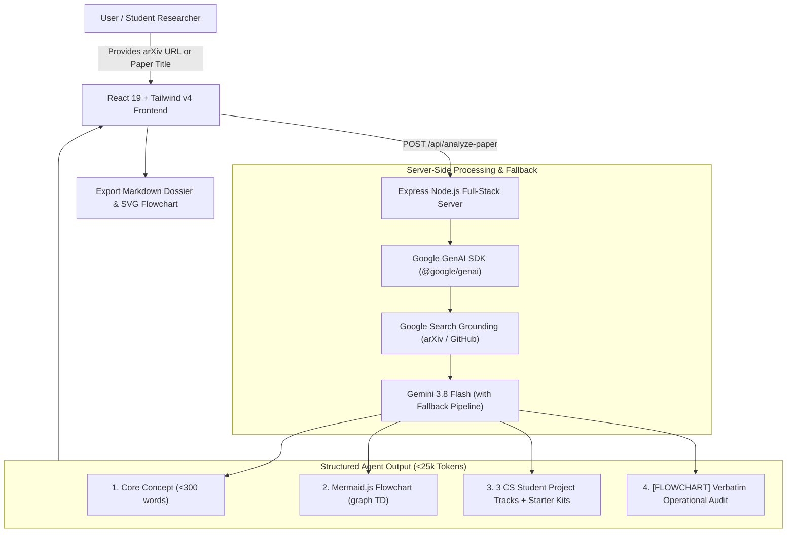

# 🎓 PaperArchitect: CS Research & Architecture Agent

> **An advanced Computer Science Research Agent specializing in parsing academic papers, synthesizing system architectures into interactive Mermaid.js flowcharts, and engineering resume-grade project opportunities for students.**

[](LICENSE)
[](https://www.typescriptlang.org/)
[](https://react.dev/)
[](https://ai.google.dev/)
[](https://tailwindcss.com/)
[](https://mermaid.js.org/)

---

## 📌 Overview

Reading academic CS papers can be intimidating, and bridging the gap between theoretical breakthroughs and practical implementation is a common challenge for students and researchers.

**PaperArchitect** acts as an AI research collaborator. Provide any arXiv paper URL, title, or abstract, and the agent executes a structured analysis:

1. **Core Concept Extraction (< 300 words)**: Clear, accessible plain-language synthesis breaking down the problem statement, primary methodology, and mathematical/algorithmic breakthroughs with a real-time word counter.
2. **System Architecture Flowcharts (`Mermaid.js`)**: Clean, interactive `graph TD` diagrams mapping components, data inputs, model layers, and tensor outputs with live in-browser editing, zooming, and SVG vector export.
3. **Future Work & 3rd-Year CS Student Projects**: 3 realistic, resume-ready project extensions with exact modifications, targeted performance metrics, recommended tech stacks, ready-to-use resume bullet formulations, and downloadable PyTorch starter kits.
4. **Token Efficiency Guarantee**: Enforces an operational ceiling strictly **well under 25,000 tokens** using web search grounding for long papers.
5. **Interactive Research Advisor Q&A**: Ask follow-up technical questions on tensor shapes, mathematical intuition, and deployment strategies.

---

## ✨ Key Features

- **⚡ Token-Efficient Grounding**: Leverages Google Search grounding to retrieve abstracts, arXiv metadata, and open-source GitHub implementations to stay well within strict token budgets.
- **📊 Interactive Architecture Canvas**:
  - Live Mermaid `graph TD` rendering with zoom, pan, and reset controls.
  - In-browser graph code editor for real-time diagram tweaking.
  - 1-click **Export SVG** for high-resolution paper/presentation diagrams.
  - Component inspector detailing tensor dimensions (e.g. $[B, L, D] \to [B, L, N]$) and layer roles.
- **💼 Resume & Portfolio Incubator**:
  - Tailored specifically for **3rd-year CS students** building distinctive projects.
  - Highlights exact architectural extensions (e.g., swapping dense attention with Mamba SSMs or kernelized linear approximations).
  - Ready-to-copy bullet formulations following the Google X-Y-Z formula (*"Accomplished [X] as measured by [Y], by doing [Z]"*).
- **🛠️ Runnable Starter Kits**:
  - Automatically generates runnable `model.py` (PyTorch modules), `benchmark.py` (latency & memory profiler), `README.md`, and Google Colab free-tier GPU instructions.
- **🛡️ Multi-Model Fallback & High-Availability**:
  - Server-side backoff and automatic failover across `gemini-3.8-flash`, `gemini-flash-latest`, and `gemini-3.1-flash-lite` to resist upstream traffic spikes and 503 errors.
- **📑 Research Dossier Export**: One-click export to a complete, publication-ready Markdown file.

---

## 🏗️ Architecture



---

## 🚀 Quickstart

### Prerequisites

- [Node.js](https://nodejs.org/) (v18+ recommended)
- A [Gemini API Key](https://aistudio.google.com/app/apikey)

### Installation

1. **Clone the repository:**
   ```bash
   git clone https://github.com/your-username/paper-architect.git
   cd paper-architect
   ```

2. **Install dependencies:**
   ```bash
   npm install
   ```

3. **Configure environment variables:**
   Copy `.env.example` to `.env`:
   ```bash
   cp .env.example .env
   ```
   Add your Gemini API key in `.env`:
   ```env
   GEMINI_API_KEY="your-gemini-api-key-here"
   PORT=3000
   ```

4. **Start the development server:**
   ```bash
   npm run dev
   ```
   Open [http://localhost:3000](http://localhost:3000) in your browser.

5. **Build for production:**
   ```bash
   npm run build
   npm start
   ```

---

## 🧪 Pre-loaded Benchmark Papers

Try PaperArchitect instantly with 3 curated foundational machine learning papers:

| Benchmark Paper | Key Breakthrough | Extension Project Example |
| :--- | :--- | :--- |
| **Mamba: Linear-Time Sequence Modeling with Selective State Spaces** *(Gu & Dao, 2023)* | Hardware-aware dynamic associative scan in GPU SRAM with linear $O(N)$ scaling | *Edge-Mamba Vision Backbone for Embedded Drone Cameras (3.8x throughput)* |
| **Attention Is All You Need** *(Vaswani et al., Google Brain, 2017)* | Scaled Dot-Product Multi-Head Self-Attention eliminating recurrence | *Grouped-Query Attention (GQA) & Kernelized Linear Fast-Attention* |
| **LoRA: Low-Rank Adaptation of Large Language Models** *(Hu et al., Microsoft, 2021)* | Low intrinsic rank update matrices $W = W_0 + \frac{\alpha}{r}BA$ with zero inference latency | *Serverless Multi-Tenant LoRA Hot-Swapping Engine (<3ms latency)* |

---

## 💻 Tech Stack

- **Frontend**: React 19, TypeScript, Tailwind CSS v4, Lucide Icons, Motion
- **Flowchart Rendering**: [Mermaid.js](https://mermaid.js.org/) (Dynamic SVG generation & theme synchronization)
- **Backend**: Express.js, `tsx`
- **AI / LLM Engine**: `@google/genai` (Gemini 3.8 Flash, with dynamic fallbacks to Flash-Latest and Flash-Lite)
- **Grounding Tools**: Google Search Tool integration for arXiv metadata & code search

---

## 📂 Project Structure

```
├── .env.example              # Environment variables template
├── index.html                # App entry point with meta cards
├── metadata.json             # AI Studio metadata
├── package.json              # Dependencies and scripts
├── server.ts                 # Full-stack Express server + Gemini fallback pipeline
├── src/
│   ├── App.tsx               # Main application workspace and views
│   ├── main.tsx              # React DOM mounting
│   ├── index.css             # Tailwind CSS & custom animations
│   ├── components/
│   │   ├── ArchitectureInspector.tsx # Component layer & tensor shape inspector
│   │   ├── CoreConceptView.tsx       # <300 words core concept card with word counter
│   │   ├── MermaidChart.tsx          # Interactive Mermaid flowchart viewer & live editor
│   │   ├── PaperQnADrawer.tsx        # Technical Q&A assistant drawer
│   │   ├── RawOutputView.tsx         # Verbatim agent output audit tab
│   │   ├── StarterKitModal.tsx       # PyTorch code, benchmark scripts & Colab instructions
│   │   └── TokenGauge.tsx            # <25,000 token budget meter
│   └── data/
│       └── samplePapers.ts   # Benchmark papers dataset & TypeScript interfaces
└── tsconfig.json             # TypeScript configuration
```

---

## 🤝 Contributing

Contributions, feedback, and paper requests are welcome!
1. Fork the Project
2. Create your Feature Branch (`git checkout -b feature/AmazingFeature`)
3. Commit your Changes (`git commit -m 'Add some AmazingFeature'`)
4. Push to the Branch (`git push origin feature/AmazingFeature`)
5. Open a Pull Request

---

## 📄 License

Distributed under the Apache License 2.0. See `LICENSE` for more information.
